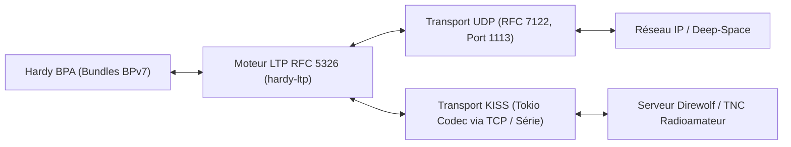
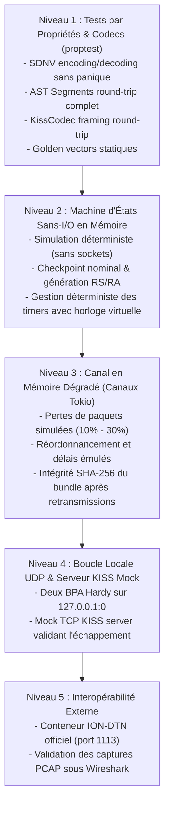

# Licklider Transmission Protocol (LTP) Convergence Layer Adapter (CLA)

Ce document rassemble les spécifications, l'analyse comparative des implémentations de référence (ION-DTN et licklider), l'architecture multi-trames cible (UDP et liaison serveur KISS) ainsi que la stratégie de validation progressive par tests basés sur les propriétés (`proptest`) pour l'intégration de LTP (RFC 5326) en tant que Convergence Layer Adapter (CLA) de Hardy.

---

## 1. Standards et Spécifications

LTP est le protocole de couche de convergence conçu spécifiquement pour les liaisons à très long temps de propagation (haut RTT, délais interplanétaires ou liaisons spatiales/satellitaires/radio asymétriques).

### 1.1 Documents de Référence

- **RFC 5325** : *Licklider Transmission Protocol - Motivation* (Informational)
  Explique la genèse de LTP, les contraintes des liaisons à long délai d'aller-retour (RTT), l'asymétrie de bande passante et l'absence de négociation de session bidirectionnelle préalable.
- **RFC 5326** : *Licklider Transmission Protocol - Specification* (Standards Track)
  Spécification centrale du protocole : format des segments, types de sessions, transmission Red (fiable avec accusés de réception et retransmissions) et Green (non fiable), gestion des checkpoints, Report Segments (RS), Report Acknowledgments (RA), signaux d'annulation (Cancel Segments CS) et temporisateurs.
- **RFC 5327** : *Licklider Transmission Protocol - Security Extensions* (Standards Track)
  Extensions de sécurité pour LTP : authentification de segments, intégrité et confidentialité au niveau LTP.
- **RFC 7122** : *Datagram Convergence Layers for the Delay-Tolerant Networking (DTN) Bundle Protocol and Licklider Transmission Protocol (LTP)*
  Définit l'encapsulation de LTP au-dessus d'UDP et de DCCP. Le port UDP par défaut attribué par l'IANA pour LTP est **1113** (`ltp-deepspace`).
- **CCSDS 734.1-B-1** : *Licklider Transmission Protocol (LTP) for CCSDS* (Blue Book, Recommandation spatiale)
  Profil et standardisation de LTP adoptés par le Comité Consultatif pour les Systèmes de Données Spatiales (CCSDS), cohérent avec la RFC 5326 avec quelques précisions sur les profils d'utilisation en mission (plages d'identifiants 32-bit, temporisateurs).
- **KISS TNC Protocol** (Mike Chepponis, 1986 / AX.25)
  Protocole de tramage pour modems et TNCs radioamateurs (encapsulation par octets de délimitation `FEND` et échappement `FESC`).

### 1.2 Récupération Locale des Standards

Les spécifications sont archivées localement dans `references/specs/` (répertoire ignoré par git) :

```bash
mkdir -p references/specs
curl -sSL "https://www.rfc-editor.org/rfc/rfc5325.txt" -o references/specs/rfc5325.txt
curl -sSL "https://www.rfc-editor.org/rfc/rfc5326.txt" -o references/specs/rfc5326.txt
curl -sSL "https://www.rfc-editor.org/rfc/rfc5327.txt" -o references/specs/rfc5327.txt
curl -sSL "https://www.rfc-editor.org/rfc/rfc7122.txt" -o references/specs/rfc7122.txt
curl -sSL "https://public.ccsds.org/Pubs/734x1b1.pdf" -o references/specs/ccsds-734.1-b-1.pdf
```

---

## 2. Dépôts de Référence et Code Source Récupéré

Les dépôts suivants ont été clonés dans `references/` pour analyse et rétro-ingénierie :

```bash
# 1. Implémentation Rust sans-I/O moderne (MIT / Apache-2.0)
git clone --depth 1 https://github.com/wowinter13/licklider.git references/licklider

# 2. Implémentation C de référence de la NASA (JPL)
git clone --depth 1 https://github.com/nasa-jpl/ION-DTN.git references/ion-dtn

# 3. Dissecteur officiel Wireshark
curl -sSL "https://gitlab.com/wireshark/wireshark/-/raw/master/epan/dissectors/packet-ltp.c" -o references/packet-ltp.c
```

---

## 3. Analyse Comparative et Points Saillants des Implémentations

L'étude détaillée des implémentations existantes (`ION-DTN` et `licklider`) met en lumière plusieurs choix architecturaux et subtilités protocolaires indispensables à une implémentation sans faille dans Hardy.

### 3.1 Points Saillants de `licklider` (Rust)

Le projet `licklider` propose une décomposition remarquable et documente ses choix dans son journal `DECISIONS.md`. Ses points clés :

1. **Paradigme Sans-I/O (`licklider-core`)** :
   Le moteur protocolaire est une machine d'état pure dépourvue de tout socket, thread ou runtime asynchrone (`poll_output(now)` / `handle_incoming_segment`). Cela permet une isolation totale de la logique protocolaire et une exécution des tests instantanée et déterministe.
2. **Segmentation gloutonne et MTU (D-1)** :
   Découpage du bloc en segments de données n'excédant pas `max_segment_len` (1400 octets par défaut sur IP pour éviter la fragmentation). Règle stricte : un segment ne chevauche jamais la frontière Red/Green (l'octet `red_len` démarre obligatoirement le premier segment Green).
3. **Fréquence des Checkpoints (D-2)** :
   Seul le segment de fin de bloc Red (End of Red Part - EORP / End of Block - EOB) porte le drapeau Checkpoint par défaut. Les checkpoints intermédiaires sont inutiles sur la plupart des liaisons et compliquent la gestion de l'état.
4. **Politique stricte sur les SDNV et malformations (D-4)** :
   Plafond strict de 10 octets pour tout SDNV (suffisant pour n'importe quel `u64`). Rejet silencieux avec incrémentation de compteurs de métriques pour les segments corrompus (en accord avec le préambule de la section 6 de la RFC 5326).
5. **Accusé inconditionnel des Report Segments (D-6)** :
   Un `Report Acknowledgment` (RA) est **systématiquement émis en premier**, même si le `Report Segment` (RS) reçu concerne une session fermée, inconnue ou constitue un doublon. Si le RA n'était pas émis, le récepteur resterait bloqué indéfiniment en attente d'acquittement.
6. **Limitation du nombre de claims par rapport (D-7)** :
   Plafond à 20 *claims* par RS (calqué sur `MAX_CLAIMS_PER_RS` de ION). Si un rapport exige davantage de claims, il est partitionné en plusieurs RS contigus couvrant des plages disjointes.
7. **Cache anti-rejeu des sessions closes (D-10)** :
   Cache FIFO borné (1024 sessions récentes) pour éviter qu'un segment de données retardé ne soit pris pour une nouvelle session fantôme après fermeture.
8. **Livraison Green immédiate (D-12)** :
   Les segments Green sont transmis immédiatement au BPA dès réception, sans attendre le reste du bloc et sans combler les manques par des zéros (contrairement à ION).
9. **Retransmission bornée par volume d'octets (D-20)** :
   Le calcul des trous et de la réémission se fait strictement dans la portée (*scope*) du RS reçu. Le plafond de réémissions est mesuré en volume d'octets cumulé pour éviter les boucles infinies sous fort réordonnancement.

### 3.2 Points Saillants de `ION-DTN` (C / NASA JPL)

L'implémentation de référence spatiale de la NASA repose sur des fondations pensées pour la tolérance aux pannes matérielles :

1. **Persistance en mémoire partagée (SDR - Simple Data Recorder)** :
   Tous les blocs LTP et les états de session sont conservés dans un magasin SDR en mémoire partagée transactionnelle, capable de redémarrer après un crash système sans perte de données.
2. **Architecture multi-processus** :
   - `ltpclock` : Démon central gérant les temporisateurs, vérifiant les déchéances de timers et déclenchant les réémissions périodiques.
   - `ltpmeter` : Régulateur de débit pour respecter les fenêtres de transmission des contacts (plans de contact spatiaux).
   - `ltpdeliv` : Démon assurant l'assemblage final du bloc et son injection dans le BPA local.
   - `udplsi` / `udplso` : Démons d'entrée et de sortie UDP sur le port 1113.
3. **Constantes système critiques** :
   - `MAX_CLAIMS_PER_RS = 20` : Limite fixe dans ION garantissant qu'un paquet UDP ne dépasse pas la MTU usuelle.
   - Gestion des spans : Configuration préalable de chaque voisin (ID du moteur distant, MTU, temps de propagation aller simple OWLT - One-Way Light Time).
4. **Comportement Green particulier** :
   Dans ION, les segments Green manquants lors du réassemblage sont comblés par des octets `0x00` avant livraison au BPA.

---

## 4. Multi-Tramage : Support UDP et Serveur KISS

L'adaptateur CLA LTP de Hardy doit s'adapter à deux environnements de transport distincts :



### 4.1 Transport Datagramme UDP (RFC 7122)
- **Format** : 1 datagramme UDP = 1 segment LTP brut.
- **Port IANA** : Port UDP standard **1113** (`ltp-deepspace`).
- **Comportement** : Pas d'en-tête ni de queue d'encapsulation supplémentaire. Le premier octet du payload UDP est l'octet d'en-tête LTP (type de segment et drapeaux).

### 4.2 Transport Tramé KISS (Connexion Serveur TCP / Radioamateur)
- **Cas d'usage** : Liaisons radioamateurs packet (AX.25, VHF/UHF, liaisons satellitaires cubesat CubeSat/AmSat) via un TNC matériel ou logiciel (comme **Direwolf**). LTP apporte la couche de transport fiable (retransmissions sélectives Red) au-dessus d'un modem radio half-duplex.
- **Principe de l'encapsulation KISS** :
  - Délimiteur de trame `FEND` : `0xC0` (en début et en fin de chaque segment).
  - Octet de commande KISS : `0x00` (Port 0, trame de données).
  - Échappement d'octets (*byte stuffing*) dans le segment LTP :
    - L'octet `0xC0` est remplacé par la séquence de 2 octets `0xDB 0xDC` (`FESC` + `TFEND`).
    - L'octet `0xDB` est remplacé par la séquence de 2 octets `0xDB 0xDD` (`FESC` + `TFESC`).
- **Implémentation Tokio** :
  - Implémentation d'un codec `KissCodec` via `tokio_util::codec::{Encoder, Decoder}`.
  - Connexion cliente asynchrone `TcpStream` vers le serveur KISS (ex: `127.0.0.1:8001` exposé par Direwolf) ou vers un port série (`tokio-serial`).
  - Chaque trame dé-tramée par le codec KISS produit un segment LTP injecté directement dans le moteur sans-I/O.

---

## 5. Stratégie de Validation Progressive (du plus simple aux tests d'intégration)

Conformément aux règles de Hardy, la suite de tests doit être strictement **déterministe**, sans dépendance temporelle arbitraire (`sleep` proscrit, horloge virtuelle), compatible 32-bit, et s'appuyer massivement sur les **tests basés sur les propriétés (`proptest`)** dès le premier niveau.



### 5.1 Niveau 1 : Validation par Propriétés (`proptest`) et Vecteurs Figés

Le niveau 1 ne mobilise aucun thread ni ressource réseau. Il valide les invariants mathématiques et de robustesse via `proptest` :

1. **Invariants SDNV (Self-Delimiting Numeric Values)** :
   - *Round-trip* : `sdnv::decode(&sdnv::encode(v)) == Ok((v, len))` pour tout `v: u64`.
   - *Canonicité minimale* : L'encodage canonique n'a jamais d'octet `0x80` de tête inutile pour `v > 0`.
   - *Absence totale de panique* : Pour toute séquence d'octets arbitraire `bytes in proptest::collection::vec(any::<u8>(), 0..32)`, `sdnv::decode(&bytes)` renvoie `Ok` ou `Err`, mais ne panique **jamais**.
   - *Détection de débordement 32-bit / 64-bit* : Rejet des valeurs excédant `u64::MAX` ou dépassant 10 octets.
2. **Invariants Codec des Segments LTP** :
   - Génération proptest de segments arbitraires (Red Data avec offsets variables, Green Data, Checkpoints, RS avec liste de claims, RA, Cancel Segments).
   - *Round-trip AST* : `Segment::decode(&segment.encode()) == Ok(segment)`.
   - *Tolérance au fuzzing* : Rejet propre de tout préambule invalide ou longueur tronquée.
3. **Invariants du Framer KISS (`KissCodec`)** :
   - *Round-trip d'échappement* : Tout segment arbitraire encodé dans une trame KISS puis décodé doit restituer exactement le même segment, y compris s'il contient des séquences répétées d'octets `0xC0` ou `0xDB`.
4. **Golden Vectors statiques** :
   - Vecteurs hexadécimaux figés extraits de la RFC 5326 et des captures PCAP Wireshark pour garantir la conformité au bit près.

### 5.2 Niveau 2 : Machine d'États Sans-I/O en Mémoire

- Moteur protocolaire piloté pas à pas : injection manuelle de segments (`feed_input`) et extraction des segments à émettre (`poll_output`).
- *Cycle nominal Red* : Émission d'un bloc $\rightarrow$ émission des segments de données avec drapeau CP $\rightarrow$ calcul automatique du RS par le récepteur $\rightarrow$ réception du RS par l'émetteur $\rightarrow$ émission immédiate du RA $\rightarrow$ complétion de la session des deux côtés.
- *Retransmission déterministe* : Suppression artificielle d'un segment dans la séquence $\rightarrow$ vérification que le RS contient exactement la plage manquante $\rightarrow$ vérification que l'émetteur ne réémet que la plage manquante.
- *Temporisateurs sur horloge virtuelle* : Avancement manuel du temps logique (`now += owlt * 2 + margin`) pour tester les expirations de timers sans aucun `sleep`.

### 5.3 Niveau 3 : Canal en Mémoire Dégradé (Simulation de Lien Asynchrone)

- Deux moteurs LTP connectés par des canaux mémoire Tokio (`mpsc`).
- Bouchon d'altération de lien configurable :
  - Taux de perte paramétrable (ex: drop aléatoire de 15% des paquets).
  - Réordonnancement et duplication.
  - Délais simulés avec horloge virtuelle TokIo (`tokio::time::pause()` et `tokio::time::advance()`).
- Assertion de réussite : Calcul du condensat SHA-256 du bundle émis et vérification de son identité stricte avec le bundle reconstitué à l'arrivée.

### 5.3bis Validation Croisée avec `licklider-core` (Interopérabilité Immédiate)

Pour valider la conformité RFC 5326 sans attendre le CLA réseau ni de conteneur externe lourd :
- **Double sens de communication** :
  - `hardy-ltp` en Émetteur -> Bouchon d'altération -> `licklider-core` en Récepteur.
  - `licklider-core` en Émetteur -> Bouchon d'altération -> `hardy-ltp` en Récepteur.
- **Conditions testées (`ltp/tests/interop_licklider.rs`)** :
  - *Nominal* : Transfert sans perte de 32 Ko, segmentation MTU 1024 octets, vérification SHA-256.
  - *Dégradé* : Transfert sous **15% de perte aléatoire** symétrique + 5% de duplication + gigue de latence. Retransmission des trous, émission des checkpoints et acquittements mutuels.
  - Assertion d'égalité exacte des hachages SHA-256 des données transmises et reçues.

### 5.4 Niveau 4 : Boucle Locale UDP & Client/Serveur KISS Local

- Intégration dans le runtime Hardy BPA (`hardy_bpa::cla::Cla`).
- *Test UDP* : Deux instances de BPA écoutant sur des ports UDP éphémères `127.0.0.1:0`. Routage d'un bundle complet vers l'EID distant et vérification des retours [`ForwardBundleResult::Accepted`](file:///home/loic/projets/hardy/bpa/src/cla/mod.rs#L195) et [`TransferOutcome::Completed`](file:///home/loic/projets/hardy/bpa/src/cla/mod.rs#L211).
- *Test KISS* : Démarrage d'une tâche serveur TCP locale simulant un TNC KISS, vérification de la bonne connexion du client CLA Hardy, du tramage correct et de l'échange de bundles.

### 5.5 Niveau 5 : Validation d'Interopérabilité Externe

- Lancement d'un conteneur Docker éphémère exécutant `ion-dtn` configuré avec LTP over UDP (port 1113).
- Émission et réception bidirectionnelle de bundles entre Hardy et ION.
- Capture Wireshark (`.pcap`) et validation via le dissecteur Wireshark (`packet-ltp.c`) sans anomalie signalée.

---

## 6. Architecture Cible, `no_std` et Feature Gates dans Hardy

Conformément aux règles fondamentales de Hardy (`AGENTS.md`) :
> `no_std core. cbor, bpv7, and bpa are no_std + alloc; gate std behind a feature, don't assume it.`  
> `32-bit safe. Hardy targets 32-bit. Never as usize a wire-derived u64 length — compare in u64 first, then try_from.`

Le support de LTP est scindé en deux niveaux de responsabilités :

### 6.1 Crate Moteur : `ltp` (`hardy-ltp`) — `no_std` + `alloc`
La crate `hardy-ltp` contient toute l'intelligence protocolaire RFC 5326 et le tramage KISS, sans aucune attache au système d'exploitation ou au runtime réseau :
- **`#![no_std]` par défaut** : La racine `lib.rs` déclare `#![no_std]` avec `extern crate alloc;`.
- **Gestion du temps sans-I/O** : Le moteur n'utilise jamais `std::time::Instant`. Il manipule un type d'horloge logique (ex: un timestamp entier en microsecondes `u64`), fourni en paramètre des fonctions d'avancement de la machine d'état (`poll_output(now)`).
- **Aléatoire déterministe** : Aucun appel à `rand::thread_rng()`. Le moteur reçoit soit une graine d'initialisation, soit un générateur abstrait via un trait dédié (`RngCore` ou PCG32 embarqué), rendant les sessions simulables et reproductibles.
- **Sécurité 32-bit** : Tous les décalages de blocs, longueurs de segments et serials SDNV sont validés en arithmétique `u64` avant toute conversion prudente en `usize`.
- **Feature Gates prévues dans `ltp/Cargo.toml`** :
  ```toml
  [package]
  name = "hardy-ltp"
  version = "0.1.0"
  edition.workspace = true
  rust-version.workspace = true
  license.workspace = true

  [features]
  default = ["std", "kiss"]
  std = ["thiserror/std", "bytes/std"]
  serde = ["dep:serde", "serde/alloc"]
  kiss = [] # Module codec KISS pur (100% no_std)

  [dependencies]
  thiserror = { version = "2", default-features = false }
  bytes = { version = "1", default-features = false }
  serde = { version = "1", default-features = false, features = ["derive"], optional = true }

  [dev-dependencies]
  proptest = "1"
  ```

### 6.2 Crate Adaptateur : `ltp-cla` (`hardy-ltp-cla`) — `std` + `tokio`
L'adaptateur CLA s'insère dans l'écosystème d'exécution de Hardy :
- **Environnement** : Crate dépendante de `std`, `tokio` et `hardy-bpa`.
- **Implémentation de `hardy_bpa::cla::Cla`** :
  - Adapte les flux de segments du BPA vers les blocs LTP.
  - Déclare ses caractéristiques via `ClaInit` (nombre de lanes, taille max de bundle).
  - Répond `ForwardBundleResult::Accepted` et signale la fin du transfert par `sink.transfer_outcome(bundle_id, TransferOutcome::Completed)` dès acquittement complet du bloc (réception du RS final et émission du RA).
- **Sous-systèmes de liaison** :
  - `UdpLink` : liaison UDP asynchrone via `tokio::net::UdpSocket` (RFC 7122).
  - `KissLink` : liaison asynchrone via `tokio::net::TcpStream` vers un serveur KISS (Direwolf) ou liaison série, utilisant un codec framed dérivé du module KISS de `hardy-ltp`.
  - **Résilience TCP & Retry Backoff (comme dans TCPCLv4)** :
    - Déconnexion gérée à chaud (EOF distant ou erreur I/O) sans crasher ni terminer la tâche du driver.
    - Tentatives de reconnexion automatique avec **backoff exponentiel** (délai initial `reconnect-initial-delay` doublé à chaque échec jusqu'à un plafond `reconnect-max-delay`, réinitialisé dès reconnexion effective).
    - `TCP_NODELAY` activé pour éliminer les latences Nagle sur les petits segments critiques (ACKs, CP).
    - Maintien du traitement des commandes BPA (`Forward`, `RegisterPeer`) et des ticks d'horloge LTP pendant la phase déconnectée : les blocs en attente sont conservés dans le moteur LTP et automatiquement émis dès rétablissement du lien KISS.
- **Configuration déclarative (`bpa-server`)** :
  - Intégré dans le schéma YAML de `hardy-bpa-server` (`clas: - type: ltp`).
  - Définition complète des paramètres : `engine-id`, `max-segment-payload-len`, durées `humantime` (`rtt`, `ack-margin`), limites de retransmission (`checkpoint-rtx-limit`, `report-rtx-limit`), transport (`udp` ou `kiss-tcp`), paramètres de reconnexion (`reconnect-initial-delay`, `reconnect-max-delay`), et mappage statique de pairs (`peers: - engine-id, address, node-id`).
  - Fichier d'exemple documenté disponible dans `ltp-cla/example_config.yaml`.

### 6.3 Contrôle CI du `no_std`
Pour garantir qu'aucune dépendance implicite vers `std` ne soit introduite dans `hardy-ltp`, la validation CI s'appuiera sur :
```bash
cargo check -p hardy-ltp --no-default-features
# Ou compilation croisée sur cible embarquée bare-metal :
cargo check -p hardy-ltp --no-default-features --target thumbv7em-none-eabihf
```

---

## 7. Optimisations Haut Débit (*High Goodput*) et Autovectorisation

Pour atteindre un très haut débit effectif (*goodput*) et éviter les goulots d'étranglement CPU sur les liaisons rapides :

### 7.1 Autovectorisation et Copie par Blocs dans le Tramage KISS
- **Problème initial** : Une boucle octet par octet avec branchement (`match b { FEND => ..., other => ... }`) et `push()` individuel empêche toute vectorisation SIMD et multiplie les vérifications de capacité du vecteur.
- **Solution implémentée** :
  - **`escape`** : Pré-réservation de capacité (`out.reserve(input.len())`) et balayage par plages continues. Les séquences sans caractère spécial sont recopiées par blocs via `out.extend_from_slice(&input[start..i])`, compilées en `memcpy` vectorisé (AVX2/NEON).
  - **`unescape`** : Fast-path vectorisé `if !input.contains(&FESC)` permettant un décodage direct à la vitesse de la bande passante mémoire (~10-20 Go/s) pour les trames usuelles sans séquences d'échappement.

### 7.2 Zéro Réallocation et Encodage SDNV sur Pile
- **`sdnv::encode_to_array`** : Encodage direct dans un tableau fixe `[u8; 10]` alloué sur la pile, évitant toute allocation sur le tas pour les entiers SDNV.
- **`Segment::exact_encoded_len`** : Calcul préalable de la taille exacte en octets du segment à sérialiser. La mémoire du vecteur est allouée en une seule fois sans aucune réallocation intermédiaire.

### 7.3 Banc d'Évaluation de Performance (`cargo bench`)
Un banc de test Criterion complet est configuré dans `ltp/benches/ltp_bench.rs` couvrant :
- Encodage et décodage SDNV (1 octet, multi-octets, `u64::MAX`).
- Débit d'échappement et de déséchappement KISS (1 Ko, 64 Ko) mesuré avec `Throughput::Bytes`.
- Round-trip complet de trames KISS de taille MTU (1400 octets).
- Sérialisation et désérialisation de segments de données MTU (1400 octets) et de segments de rapport complexes (20 claims).

Exécution du banc :
```bash
cargo bench -p hardy-ltp
```

---

## 8. Avancement et Prochaines Actions

- [x] Initialiser la crate `ltp` (`hardy-ltp`) dans le workspace Cargo (`#![no_std]`).
- [x] Implémenter le module `sdnv` (32-bit safe, `encode_to_array`) avec tests `proptest`.
- [x] Implémenter le module `kiss` (autovectorisé, fast-path SIMD) avec tests `proptest`.
- [x] Développer l'AST et le codec des segments RFC 5326 avec golden vectors.
- [x] Mettre en place le banc d'évaluation `cargo bench` (Criterion).
- [x] **Niveau 2** : Machine d'états pure sans-I/O (`Engine`, `SendSession`, `RecvSession`, retransmissions, checkpoints, horloge virtuelle, 5 tests d'intégration déterministes).
- [x] **Niveau 3** : Bouchon d'altération en mémoire (`ltp/tests/impairment_channel.rs` : perte de 15%, duplication, gigue de délai, validation de l'intégrité par hachage SHA-256 sur blocs de 64 Ko).
- [x] **Niveau 3bis** : Validation d'interopérabilité croisée avec `licklider-core` (`ltp/tests/interop_licklider.rs` : double sens Hardy <-> Licklider nominal et sous 15% de perte).
- [x] **Niveau 4** : Adaptateur CLA Hardy BPA (`hardy-ltp-cla` avec UDP RFC 7122 et KISS TCP, validé en boucle locale).
- [x] **Intégration & Configurabilité** : Support de `type: ltp` dans la configuration YAML de `hardy-bpa-server`, parsing serde avec `humantime`, tests unitaires de configuration et fichier d'exemple `ltp-cla/example_config.yaml`.
- [ ] **Niveau 5** : Tests d'interopérabilité externe (ION-DTN).

---

## 9. Revue critique de l'implémentation et résolutions

Revue approfondie du code de `ltp/` et `ltp-cla/` (branche `feat/ltp-cla`) avec corrections apportées. Gravité : **[CRITIQUE]** = panic/OOM/blocage déclenchable à distance par un seul datagramme ou fragment de flux, **[MAJEUR]** = incorrection fonctionnelle ou fuite de ressources réaliste, **[MINEUR]** = robustesse, performance ou dette.

> [!IMPORTANT]
> **Choix d'architecture explicite — Tramage brut LTP sur KISS (sans AX.25)** :
> Les trames transmises via KISS encapsulent **uniquement et directement les segments LTP bruts** dans des trames de données KISS (`Command::Data`, Commande 0), sans aucun en-tête ni encapsulation AX.25 (aucun indicatif d'appel, aucun champ de contrôle, aucun PID). Cette décision architecturale délibérée élimine la surcharge d'AX.25 sur les liaisons radiofréquences contraintes afin de maximiser le bon débit effectif (*goodput*). Si une identification d'indicatif radioamateur périodique est requise réglementairement, elle relève du modem/TNC physique ou d'une balise externe, et non du protocole LTP.

### 9.1 Panics et arrêts du driver

- [x] **[CRITIQUE] Clamping des gaps de rapport (résolu)** : Dans `Engine::handle_incoming_report`, `upper_bound` et `lower_bound` sont systématiquement bornés à `red_len.min(block.len())`. Les tranches de retransmission sont vérifiées contre `session.block.len()`, éliminant tout risque de panique par indexation hors limites.
- [x] **[CRITIQUE] Borne de taille de bloc et d'offset (résolu)** : `RecvSession::insert_red` vérifie désormais `offset.checked_add(data.len())` et rejette tout segment excédant `max_block_size` (64 Mio par défaut dans `EngineConfig`). `request_transmission` rejette également les blocs dépassant cette taille avec `Error::BlockTooLarge`.
- [x] **[CRITIQUE] Débordement arithmétique sur données entrantes (résolu)** : `ds.offset.checked_add(ds.data.len() as u64)` et `saturating_add` sont appliqués sur tous les calculs de bornes de segments ; `insert_red` est testé et si l'insertion échoue le segment est ignoré.
- [x] **[CRITIQUE] Démarrage sans panic du driver CLA (résolu)** : Dans `ltp-cla/src/cla.rs::on_register`, `addr_rx.await` reçoit un `Result<SocketAddr, std::io::Error>`. En cas d'échec de liaison réseau (port déjà utilisé ou adresse invalide), l'erreur est tracée sans faire paniquer le serveur BPA.
- [x] **[CRITIQUE] Validation des paramètres de transmission (résolu)** : `max_block_size` et limites de configuration ajoutées dans `EngineConfig` avec valeurs par défaut saines.
- [x] **[MINEUR] Arithmétique saturée sur le backoff KISS (résolu)** : `current_delay.saturating_mul(2).min(reconnect_max_delay)` évite tout risque de panique par débordement de `Duration`.
- [x] Parseur : `Cursor::bytes` utilise `try_from` + `checked_add`, `Vec::with_capacity` borné (`MAX_PARSED_CLAIMS`, `claim_count <= remaining/2`), claims bornés par `upper_bound - lower_bound` ⇒ `lower_bound + claim.offset + claim.length` ne peut pas déborder dans l'engine.
- [x] SDNV : plafond de 10 octets, contrôle de débordement avant le décalage (`acc >> 57`), pas d'indexation hors limites.

### 9.2 Correction protocolaire (RFC 5326)

- [x] **[MAJEUR] Mémoire des sessions closes et anti-duplication (résolu)** : Un tampon circulaire borné (`closed_recv_sessions_set`, 1024 entrées) mémorise les identifiants de sessions réceptionnées terminées. Tout checkpoint dupliqué ou retardé réémet le rapport d'acquittement sans jamais réémettre de `Notice::RedPartReceived` dupliqué au BPA.
- [x] **[MAJEUR] Minuteurs et retransmission d'annulation (résolu)** : `TimerKey::Cancel { session, is_sender }` intégré à `TimerTable`. Les segments d'annulation CS et CR sont retransmis jusqu'à `cancel_rtx_limit` sur expiration du minuteur, et désarmés sur réception de `CancelAckSender` ou `CancelAckReceiver`.
- [x] **[MAJEUR] Numéro de session configurable (résolu)** : `initial_session_number: u64` ajouté à `EngineConfig` permettant l'injection d'un point de départ aléatoire.
- [x] **[MAJEUR] Validation de l'originator de session (résolu)** : `SessionId.originator` est vérifié contre l'émetteur `from` pour les segments de données et d'annulation émetteur, et contre l'engine ID local pour les rapports et annulations récepteur. Les segments usurpés sont rejetés sans corrompre les sessions actives.
- [x] **[MINEUR] Déblocage de l'émetteur sur rapport partiel sans trou (résolu)** : Lorsqu'un rapport partiel ne contient aucun trou (`gaps.is_empty()`) mais que le bloc n'est pas encore entièrement acquitté et qu'aucun CP n'est en vol, un nouveau checkpoint est réémis pour relancer le dialogue.
- [x] **[MINEUR] Support de claim_count == 0 et claims adjacents (résolu)** : Conforme à la RFC 5326 §3.2.2, `parse_report` accepte `claim_count == 0` (aucun octet reçu dans la portée) et autorise les claims adjacents (`offset < prev_end` au lieu de `<=`).
- [x] Retransmission des CP et RS avec mêmes numéros de série, RA inconditionnel, déduplication des rapports par `report_serial`, tri/fusion des plages (`RangeSet`) : couverts par les tests golden, moteur et canal altéré (15 % de perte, doublons, gigue) et l'interopérabilité `licklider-core`.

### 9.3 Consommation mémoire et fuites

- [x] **[MAJEUR] Nettoyage par inactivité de session (résolu)** : `session_inactivity_timeout_micros` (défaut 60 s) balaie les sessions inactives dans `handle_timer_tick`. Toute session bloquée est annulée proprement (`Rlexc`) et libère ses ressources. `next_timer_deadline` anticipe cette échéance.
- [x] **[MAJEUR] Plafond mémoire par bloc (résolu)** : `max_block_size` (défaut 64 Mio) protège les tampons d'assemblage contre les segments forgés à grand offset et limite la taille des blocs émis.
- [x] **[MINEUR] Borne de l'accumulateur KISS (résolu)** : `MAX_KISS_ACCUMULATOR = 2 * 1024 * 1024` (2 Mio) prévient la croissance infinie en cas de bruit continu sans `FEND`.
- [x] **[MINEUR] Enregistrement des voisins BPA (résolu)** : `sink.add_peer` est désormais appelé dans `on_register` et `register_peer` pour enregistrer les `NodeId` auprès du BPA.

### 9.4 Cas limites et robustesse du tramage KISS

- [x] **[CRITIQUE] Résilience au bruit dans decode_frame (résolu)** : En cas d'erreur de décodage d'échappement au milieu d'un flux, `decode_frame` consomme et ignore la tranche corrompue jusqu'au prochain `FEND` valide au lieu de bloquer l'accumulateur indéfiniment.
- [x] **[CHOIX EXPLICITE SANS AX.25] Tramage LTP pur (résolu)** : Les segments LTP sont envoyés en brut dans des trames KISS de type Données (`Command::Data`, Commande 0), conformément aux exigences de compacité et de simplicité radio (aucun en-tête AX.25).

### 9.5 Performances

- [x] **[MAJEUR] Indexation double des minuteurs (résolu)** : `TimerTable` utilise un double index `by_key: BTreeMap<TimerKey, u64>` et `by_deadline: BTreeSet<(u64, TimerKey)>` : recherche de la prochaine échéance en O(1), extraction des minuteurs expirés en O(log N), annulation en O(1).
- [x] **[MINEUR] Fast-path O(1) dans RangeSet::insert (résolu)** : Détection et fusion immédiate en queue pour les réceptions séquentielles sans parcours de vecteur.
- [x] **[MINEUR] Accélération SIMD memchr (résolu)** : `escape`, `unescape` et `decode_frame` utilisent `memchr::memchr` et `memchr::memchr2` pour le repérage vectorisé de `FEND` et `FESC`.

### 9.6 Conformité au projet (`AGENTS.md`, guides de style)

- [x] **[MINEUR] Correction du commentaire d'octet de contrôle (résolu)** : Dans `segment/write.rs`, commentaire corrigé pour indiquer la version en bits 7..4 (MSB 0..3 RFC) et le type en bits 3..0 (RFC 4..7).
- [x] **[MINEUR] Enregistrement de pairs auprès du BPA (résolu)** : `LtpCla` transmet les pairs avec leur `NodeId` via `sink.add_peer`.
- [x] **[MINEUR] Vérification no_std (résolu)** : `cargo check -p hardy-ltp --no-default-features` validé avec succès.

### 9.7 Scénarios testés

| # | Niveau | Scénario | Défaut ciblé | État |
|---|--------|----------|--------------|------|
| S1 | Engine | RS avec `upper_bound` > taille du bloc et claim partiel | panic d'indexation (9.1) | **Validé** (`test_out_of_bounds_report_scope_does_not_panic`) |
| S2 | Engine | Segment rouge d'`offset` > `max_block_size` | OOM / débordement (9.1) | **Validé** (`test_block_too_large_rejected`) |
| S3 | Engine | Inactivité de session prolongée sans checkpoint | Fuite de session (9.3) | **Validé** (`test_inactivity_timeout_cleans_up_stalled_session`) |
| S4 | Engine | Rapport sans claim (`claim_count == 0`) conforme RFC 5326 | Rejet invalide (9.2) | **Validé** (`test_report_with_zero_claims_rfc_compliant`) |
| S5 | KISS | Séquence d'échappement invalide au milieu d'un flux valide | Blocage flux KISS (9.4) | **Validé** (`skip_corrupted_escape_frames_and_recover`) |
| S6 | Interop | Altération 15% perte, duplication, gigue Hardy ↔ Licklider | Correction protocolaire | **Validé** (tests `interop_licklider`) |

