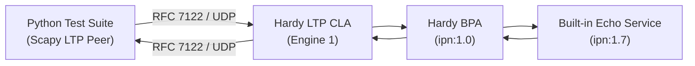

# LTP / Scapy Testbed and Packet Injection (RFC 5326 / RFC 7122)

Bidirectional interoperability testbed and raw packet injection framework between Hardy and [Scapy](https://scapy.net/) (`scapy.contrib.ltp`) over UDP.

Part of the [Hardy](https://github.com/ricktaylor/hardy) DTN Bundle Protocol implementation.

## Overview

This testbed uses Python and Scapy's official `scapy.contrib.ltp` module (originally developed by MITRE under NASA JPL contract for deep-space protocol validation) to directly test, manipulate, and fuzz LTP segments against Hardy's BPA and LTP Convergence Layer Adapter.



## Test Scenarios

The testbed exercises 10 comprehensive protocol scenarios:

| # | Test | RFC Specification | Description |
|---|---|---|---|
| 1 | `test_01_red_data_single_segment_happy_path` | RFC 5326 §6.2, §6.7, §6.8 | Single-segment Red data with Checkpoint (CP), Report Segment (RS), and Report Acknowledgment (RA) handshake |
| 2 | `test_02_red_data_multi_segment_reassembly` | RFC 5326 §6.2, §6.7 | Multi-segment Red data reception and reassembly across non-CP and CP segments with aggregate claim |
| 3 | `test_03_green_data_transfer` | RFC 5326 §6.3 | Unreliable Green data delivery without generating any Report Segment |
| 4 | `test_04_unreachable_client_service` | RFC 5326 §6.2, §8.2 | Data sent to unauthorized Client Service ID triggers Cancel Segment from Receiver `CR(UNREACH)` (reason 1) |
| 5 | `test_05_rfc7122_zero_keepalive_discard` | RFC 7122 §3.4 | 4-octet zero keep-alive datagrams (`0x00000000`) are silently discarded without error or session state |
| 6 | `test_06_rfc7122_trailing_bytes_discard` | RFC 7122 §3.3 | Datagrams containing trailing bytes after legitimate LTP segments are rejected |
| 7 | `test_07_redundant_checkpoint_idempotence` | RFC 5326 §6.8 (b) | Redundant checkpoint retransmissions preserve Report Serial number without incrementing report retries |
| 8 | `test_08_client_service_cancel_from_sender` | RFC 5326 §6.10, §6.13 | Client Service cancellation from sender `CS(USR_CNCLD)` triggers Cancel Acknowledgment `CAS` |
| 9 | `test_09_fuzzing_and_malformed_packets_resilience` | RFC 5326 / RFC 7122 | Injection of truncated, malformed SDNVs, undefined flags (5, 10, 11), and random noise without engine panic |
| 10 | `test_10_bidirectional_bp_echo_over_ltp` | RFC 9171 / RFC 5326 | End-to-end bidirectional BPv7 bundle exchange: Scapy crafts CBOR bundle to `ipn:1.7`, Hardy echoes it back over LTP |

## Prerequisites

The testbed runs using the project's Python virtual environment (`./.venv/`) with `scapy` and `cbor2`:

```bash
./.venv/bin/pip install scapy cbor2
```

## Running the Test Suite

Run the full automated test suite:

```bash
./tests/interop/scapy-ltp/run_scapy_tests.sh
```

To skip rebuilding `hardy-bpa-server` when iterating on tests:

```bash
./tests/interop/scapy-ltp/run_scapy_tests.sh --skip-build
```

## Files

- [`run_scapy_tests.sh`](run_scapy_tests.sh): Launcher script that configures and starts `hardy-bpa-server` and runs the test suite.
- [`test_scapy_ltp.py`](test_scapy_ltp.py): The 10 unittest scenarios.
- [`ltp_harness.py`](ltp_harness.py): Scapy LTP peer abstraction and RFC 9171 BPv7 bundle helper.
